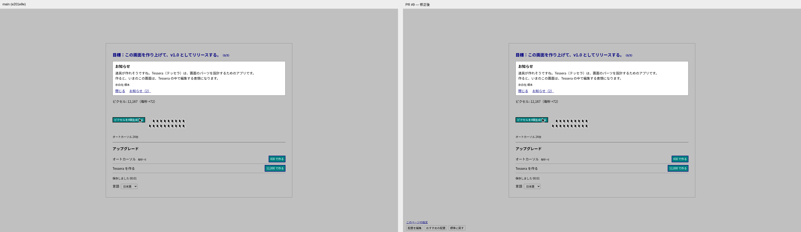

# PR #9 レビュー修正：mainとの比較

2026-11-01。[必須1点・小さな1点のレビュー](https://github.com/naoyukihonma914-png/refresh/pull/9#issuecomment-6557379928)を確認した。標準のカードと元の大きさのボタンを復元し、カーソルと台数の行を切らずに表示する。95風の写真のフォーカス枠は四角い点線にした。[実装メモ](../../実装メモ.md)。

## 左main／右修正版

mainのe201e8eを別の作業フォルダーで独立してビルドし、同じ固定状態・言語・画面サイズ・時刻・経過時間で撮影。画像を加工せず左右に置いた比較ページもブラウザで撮った。比較画像は横に長いため、開いて拡大すると文字とカーソルを確認できる。

| 場面（日本語・1920×1080） | 左右の比較 | 元画像 |
| --- | --- | --- |
| カラーの後 | [比較](seed-color-ja-1920-compare.png) | [main](seed-color-main-ja-1920.png)／[修正後](seed-color-fixed-ja-1920.png) |
| レイアウトの後 | [比較](seed-layout-ja-1920-compare.png) | [main](seed-layout-main-ja-1920.png)／[修正後](seed-layout-fixed-ja-1920.png) |
| アニメーションの後 | [比較](seed-motion-ja-1920-compare.png) | [main](seed-motion-main-ja-1920.png)／[修正後](seed-motion-fixed-ja-1920.png) |
| 素の画面の完成 | [比較](seed-complete-ja-1920-compare.png) | [main](seed-complete-main-ja-1920.png)／[修正後](seed-complete-fixed-ja-1920.png) |
| Tesseraのホーム | [比較](kumiki-mature-ja-1920-compare.png) | [main](kumiki-mature-main-ja-1920.png)／[修正後](kumiki-mature-fixed-ja-1920.png) |

[試験用言語・1366×768での比較](seed-motion-en-XA-1366-compare.png)でも、カードの輪郭・余白・自然な高さ・ボタンとカーソルの並びを維持している。

意図した差は新しい設定・編集・復旧の操作と、ホームの部品の廃止・見出しへの変更。ホームでは、生成の行より下が外した部品の分だけ短くなる。

## 検査

- 単体テスト293件、TypeScript・単一HTMLビルド、同梱書体3730文字の検査に成功。
- [main比較と編集・フォーカスの検査](checks.json)：3項目成功、ページエラー0件。5場面×3言語×2サイズの30組を撮影。素の画面のカード・見出し・通知・生成ボタン・生成の行・台数・一覧、ホームの見出し・生成ボタン・生成の行、すべてのカーソルの位置・寸法・個数を比較した。比較した寸法と座標の最大差は0px（許容差0.2px）。
- 同じ検査で、3言語×2サイズの移動・拡大・文字の収まり・カーソルと台数の表示・おすすめへの復帰も実操作した。編集を開いて閉じるだけでは標準表示を保ち、移動だけではボタンの大きさを変えない。明示的に拡大したときはボタンと文字を大きくする。[拡大した例（試験用言語・1366×768）](edited-en-XA-1366.png)。
- 3時代×3言語×2サイズで写真のスライダーをキーボード操作。[95風の点線のフォーカス枠](photo-0-ja-1920.png)を確認した。
- [段階6.3の既存のブラウザ検査](stage63-checks.json)：3項目成功、24条件、ページエラー0件。購入の解放順、色と配置の拒否、復旧、見出しと名前、設定共有、旧セーブ、保存・再読み込み・撮影を再確認した。

## 再実行

両方のビルドを別のポートの `/play/` だけで配信し、`python tools/check_review9.py --base-url http://127.0.0.1:4173 --main-url http://127.0.0.1:4174`。比較のみは `--matrix-only`、編集と写真は `--functional-only`。同じ同梱書体を使い、サイト外の通信は遮断する。

全30組の元画像・比較画像と検査結果はGit対象外の `game/artifacts/review9/` にも保存した。初回の段階6.3の画像は当時の記録として別フォルダーに残している。
