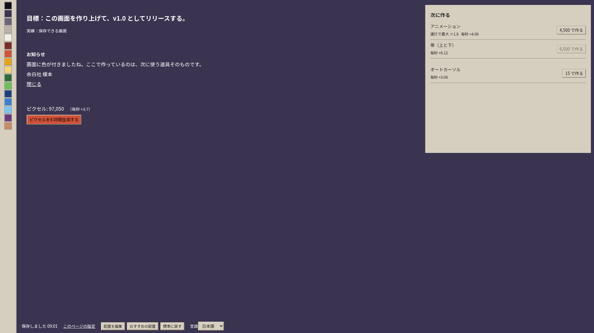
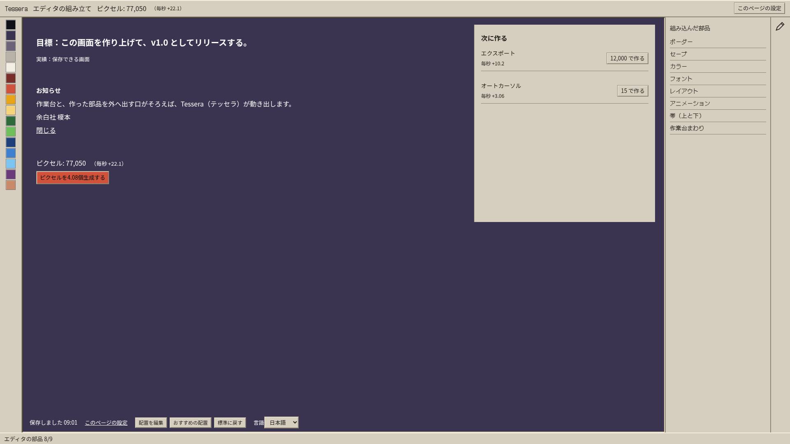

# 段階8aの確認記録

正本：仕様書第3版（main 8364bbc）。世界3の経済再設計・周回は8b、数値の最終調整も別工程。

## 8a-1 世界1の読み替え

仕様書4.1・4.2、付録A1章。9つの部品でエディタを建設し、最後のエクスポートで約1.2秒の起動へつなぐ。中央カード型の旧ホーム書類は撤去した。制作の新しい状態と旧セーブ移行は、描画機能を撤去するための基盤として先に切り替えている。

- 独立したコミットのソースから単体テスト413件・単一HTMLビルド成功。
- ブラウザ：エディタ3段 × 日本語・英語・試験用の長い英語 × 1920×1080・1366×768 の18条件で9購入と起動を実操作。ページエラー・外部通信0。
- 別の4条件で配色・書体・動き・見出し・配置変更・保存を操作。暗い作業面の文字/リンクは11.75:1、操作部品は10.95:1のコントラストを確認。
- 仮決め・再利用する基盤との境界：[実装メモ](../../実装メモ.md)。完成部品の毎秒はカーソル0台でも表示し、「構成を引き継ぐ」は設定だけを引き継ぐ。

| 配置を作った直後 | 作業台まわりを作った直後 | エクスポートを作る直前 |
| --- | --- | --- |
|  |  |  |

全撮影はGit管理外の `game/artifacts/stage8a/index.html`、追加の操作記録は `game/artifacts/stage8a-own/own-seed-checks.json`。再実行スクリプトは作業の最後に同ブランチへ追加する。

## 8a-2・8a-3

作業中。制作画面の受け入れとスクリーンショットは、実際のアプリの窓へ全操作をつないだ後に追加する。
