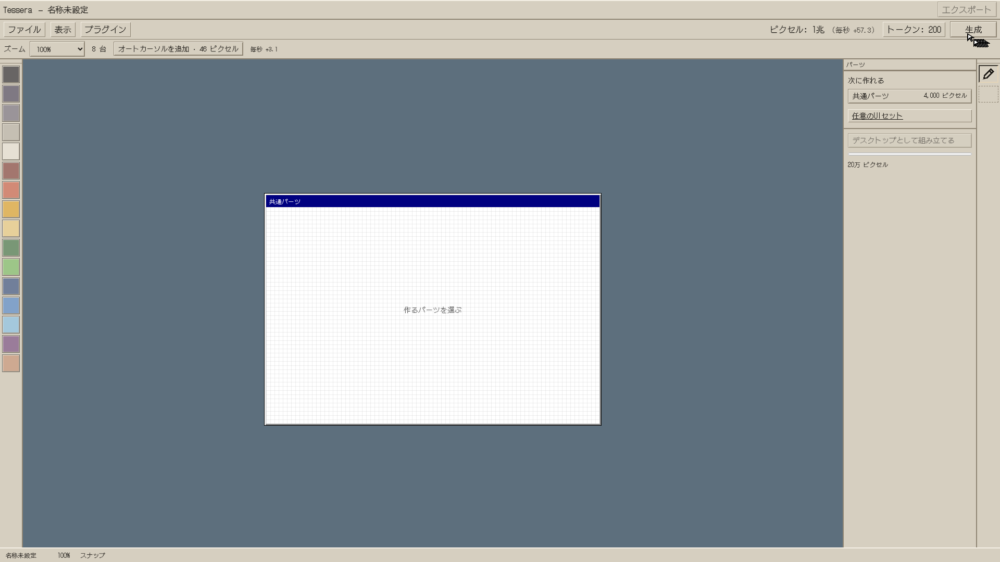
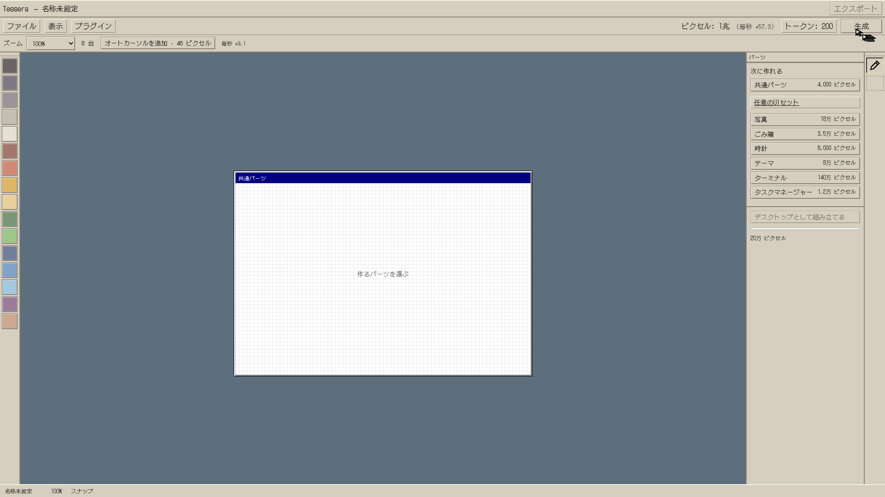
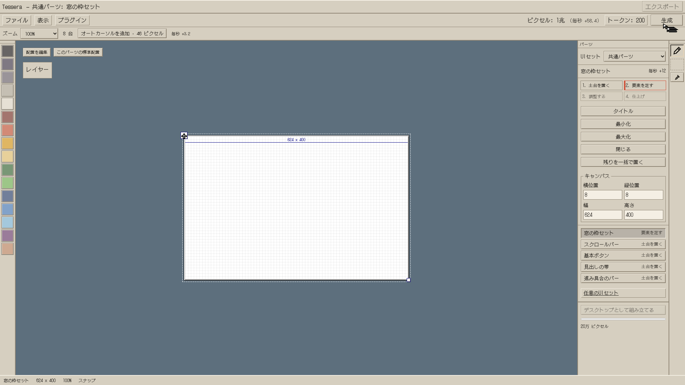
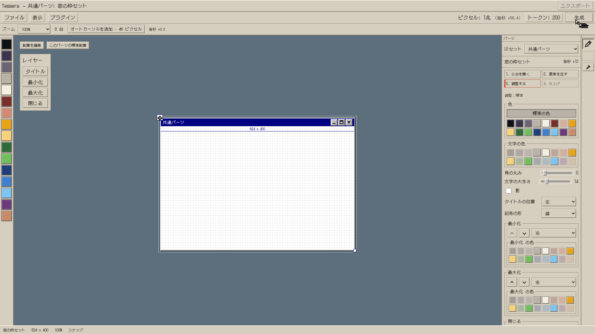
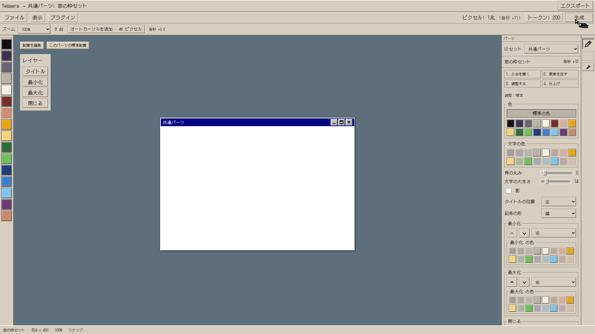
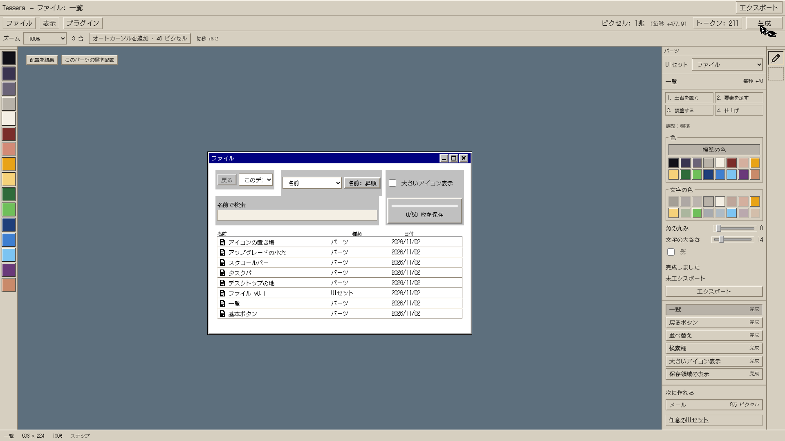
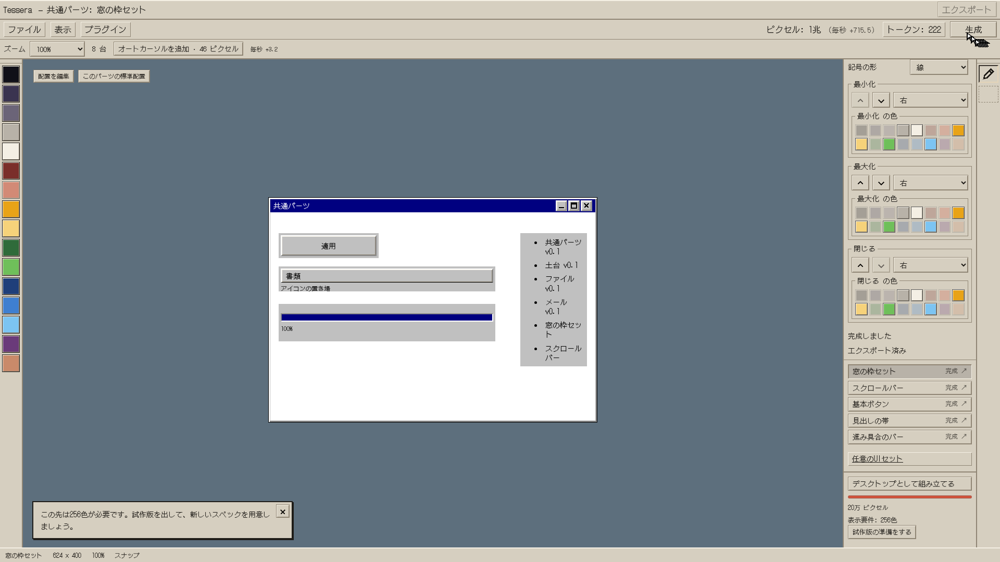
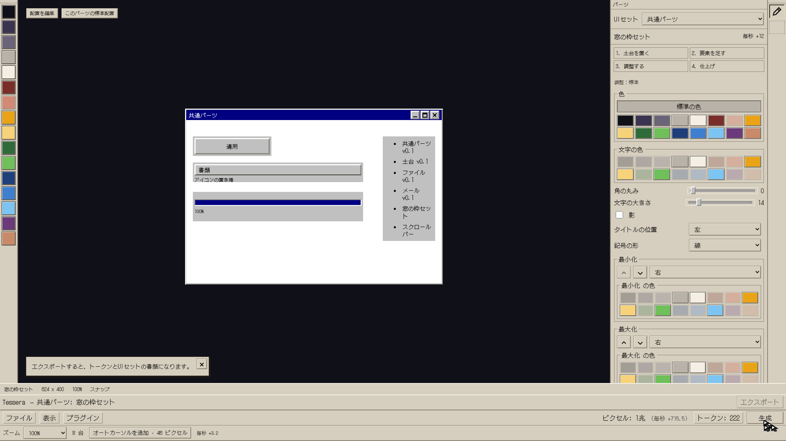

# 段階8aの確認記録

正本：仕様書第3版（main 8364bbc）。世界3の経済再設計・周回は8b、数値の最終調整も別工程。

## 8a-1 世界1の読み替え

仕様書4.1・4.2、付録A1章。9つの部品でエディタを建設し、最後のエクスポートで約1.2秒の起動へつなぐ。中央カード型の旧ホーム書類は撤去した。制作の新しい状態と旧セーブ移行は、描画機能を撤去するための基盤として先に切り替えている。

- 独立したコミットのソースから単体テスト413件・単一HTMLビルド成功。
- ブラウザ：エディタ3段 × 日本語・英語・試験用の長い英語 × 1920×1080・1366×768 の18条件で9購入と起動を実操作。ページエラー・外部通信0。
- 別の4条件で配色・書体・動き・見出し・配置変更・保存を操作。明示した暗い配色では文字/リンク11.75:1、操作部品10.95:1のコントラストを確認。
- 仮決め・再利用する基盤との境界：[実装メモ](../../実装メモ.md)。完成部品の毎秒はカーソル0台でも表示し、「構成を引き継ぐ」は設定だけを引き継ぐ。

| 配置を作った直後 | 作業台まわりを作った直後 | エクスポートを作る直前 |
| --- | --- | --- |
|  |  |  |

全撮影はGit管理外の `game/artifacts/stage8a/index.html`、追加の操作記録は `game/artifacts/stage8a-own/own-seed-checks.json`。再実行スクリプトは作業の最後に同ブランチへ追加する。

## 8a-2 制作基盤

仕様書4.2・4.9、付録A2章・C4章・F。旧描画UI・状態・文言・専用テストを撤去し、実際の行き先の窓にパーツを作る工房を新設した。本線22と写真7を含む全47、プラグイン追加2点を制作可能。セット購入は材料だけで、工程・試用・エクスポートを経て完成する。

日本語・英語・試験用の長い英語 × 工房3段 × 2サイズの18条件で、本線22＋写真7の **522パーツ・2,088工程遷移**を実操作。各条件で29トークン・5セット書類・16色の出口を確認し、ページエラーと外部通信は0件。全バリエーションは `game/artifacts/stage8a/8a2.html`。

| 入った直後 | UIセットの購入 |
| --- | --- |
|  |  |

同じ窓枠を①〜④へ進めた状態。

| ①土台 | ②要素 | ③調整 | ④試して完成 |
| --- | --- | --- | --- |
|  |  |  |  |

| ファイルセット完成 | 16色の出口 |
| --- | --- |
|  |  |

## 8a-3 自由と仕上げ

仕様書4.2・4.4・4.9・9。共通部品の自由、エディタの7設定、新しい制作プラグイン、保存形式14の移行を接続。標準の色と明示選択を区別し、文字や形だけ変えたときに勝手に配色を変えない。世界1で取ったキーボード／長押しを工房でも使えるようにした。

| 記号の並び・左右を変更 | エディタ自身を変更 |
| --- | --- |
|  |  |

- 工房3段 × ja／en／en-XA × 2サイズの18条件で、7設定すべてを実操作し、保存復帰と標準への復帰を確認。
- デスクトップ4段 × 3言語 × 2サイズの24組合せで、制作した記号から最大化・復元・移動・最小化・閉じる・再表示を実操作。
- 本線と写真以外の20パーツは、各18条件、計360件の実際の仕上げ操作も成功。任意セットと追加2点を含む。
- 統合した **414条件・1,884枚**で、ページエラー・外部通信・console warning/errorは0件。
- 記号色だけ変えても標準の帯色を保ち、保存復帰もする2条件を追加確認。
- 独立の配色4経路、世界1の背景と入力10条件、工房の入力60条件も成功。旧520×240窓を含む小窓救済7条件も確認。

最終 `npm test` は **451件すべて成功**。`npm run build` 成功、単一HTMLは約6.05MB。同梱書体3,732文字の検査も成功。テスト対象に `.test.tsx` を含めた状態での件数。書類の現在版への編集追随、58件の旧セーブ／修復検査、金額と推定時間を含む。

最初の2コミットはそれぞれ独立したソースから413件／432件とビルドを確認した。最後の完成形がこの記録の13枚。全撮影は報告用の `game/artifacts/stage8a/index.html` と `stage8a-screens.zip` へまとめ、PRには13枚だけを載せる。

管理されたChromiumが `file://` を拒否するため、ダブルクリック起動の実操作はこの環境で未確認。単一HTMLの生成と、HTTP配信で外部通信を遮断した操作は確認済み。

## 仮決めと時間診断

詳しくは [実装メモ](../../実装メモ.md)。制作先の共通枠を容器として扱うこと、オリジナリティを非経済的な変更数で示すこと、旧購入品の一度だけの返金、旧撮影の読取専用互換、一時的な試用操作を撮影が完全再現しない点を記録した。

`node tools/measure_stage8a.mjs`：毎秒2.5クリック、1部品90／135／180秒、判断4秒、初回ガイド15秒の仮定。世界1は9分06秒、本線の出口は **45分55秒／62分25秒／78分55秒**。中間は目標上限60分を2分25秒、遅い仮定は18分55秒超える。数値は調整していない。v1全体の時間やブラウザの実測時間ではない。

再実行：`cd game && npm test && npm run build`、ビルドを `/play/` で配信して `python tools/check_stage8a.py --base-url http://127.0.0.1:4173 --step 8a1 --step 8a2 --step 8a3`。任意パーツは続けて `python tools/check_stage8a.py --step 8a2 --catalog-only --resume`。Playwright・Chromiumが必要。`--help` で個別検査と撮影だけの更新を選べる。
