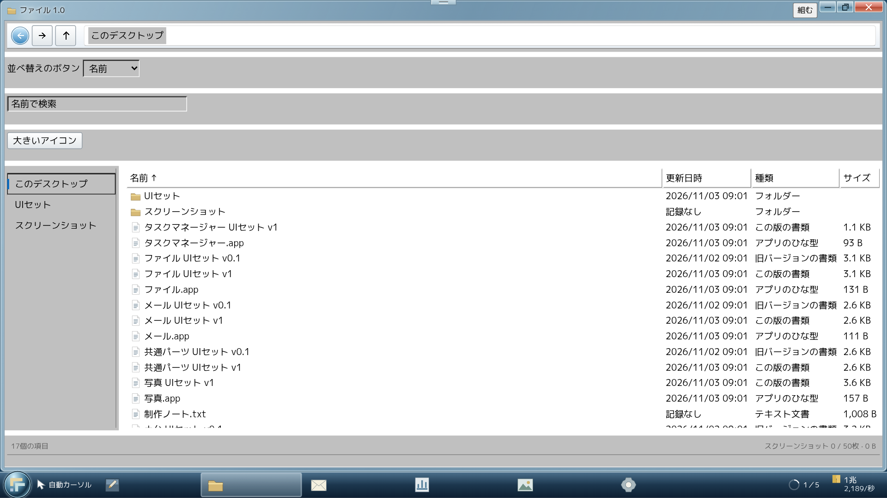
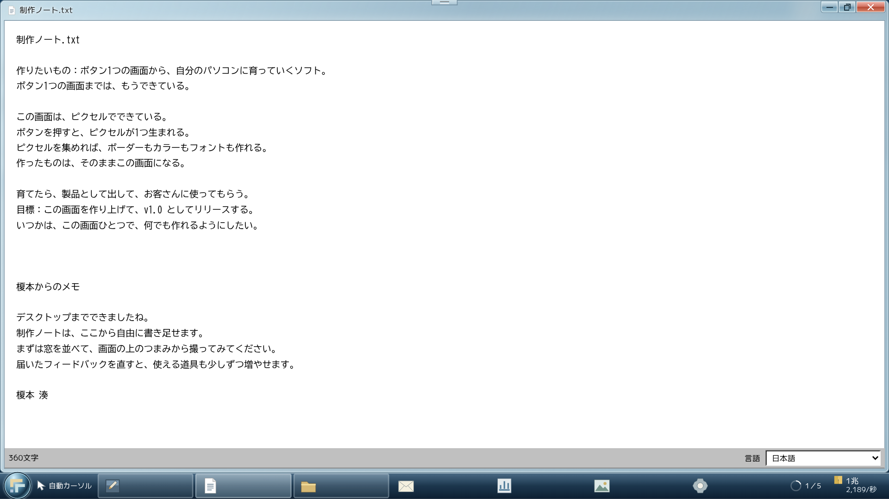
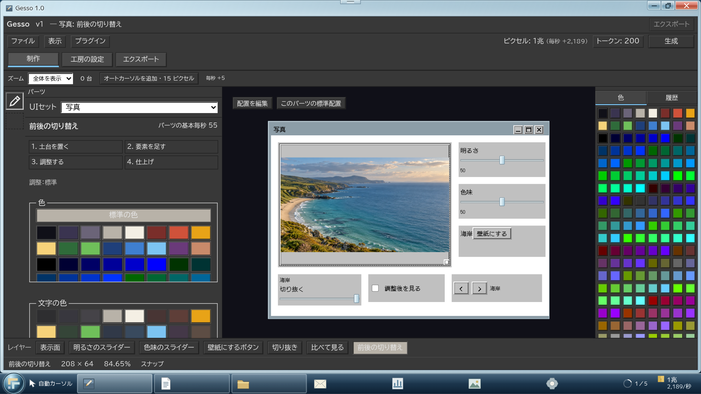
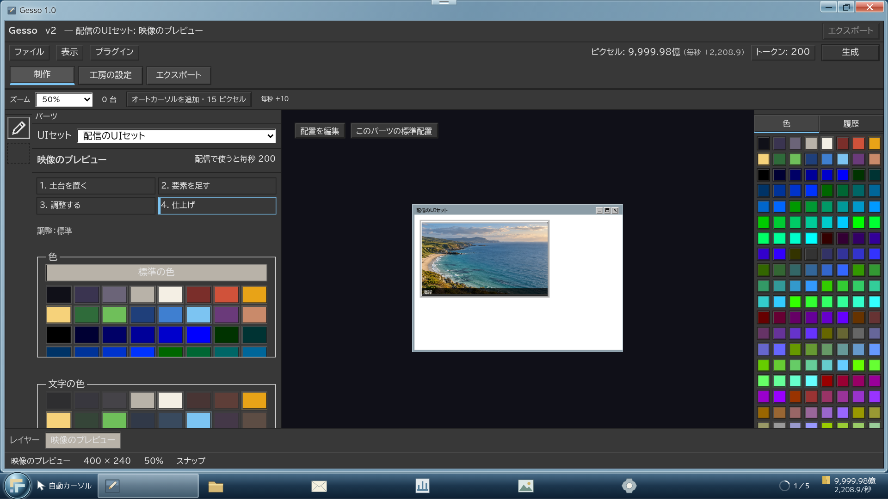
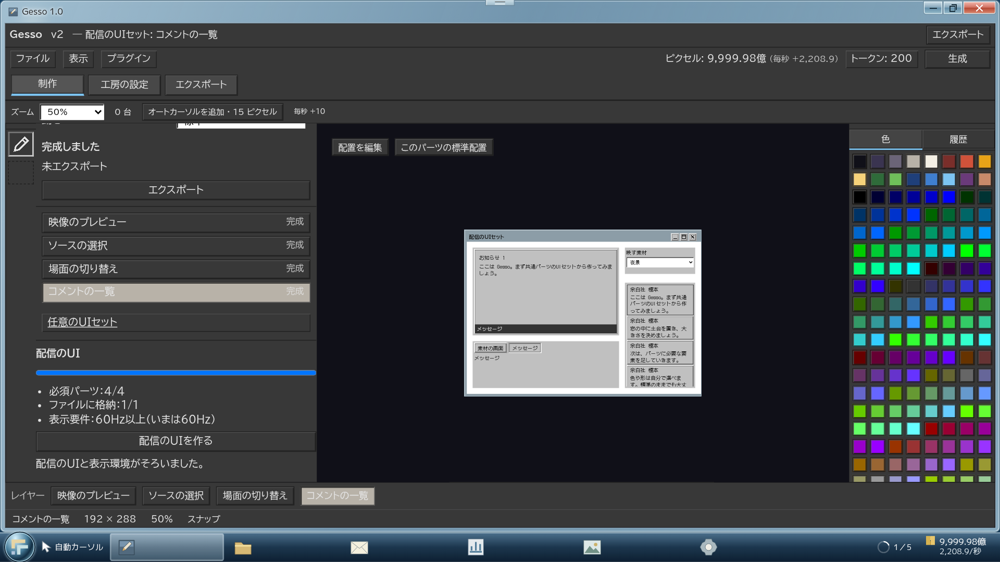
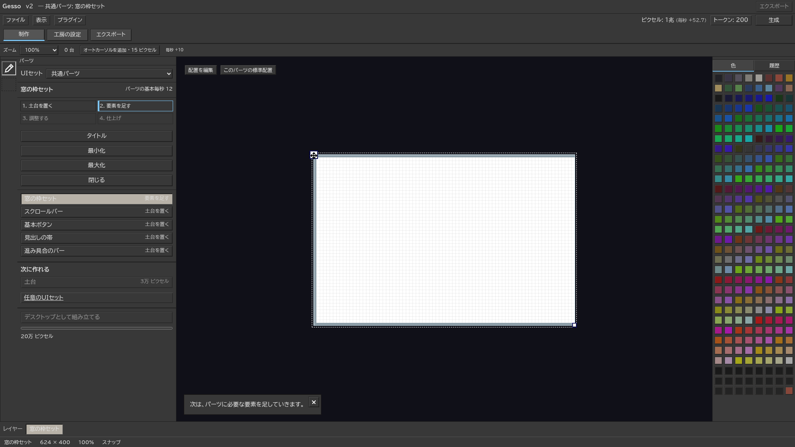

# 段階8bの確認記録

基準はmain `1f0d72a`（段階8aとPR #19を含む）、仕様書第3版、付録A/C/F。2026-11-03（日本時間）。ブランチ `codex/stage8b`、[Draft PR #20](https://github.com/naoyukihonma914-png/refresh/pull/20)。mainへはマージしない。

経済・撮影評価・ファイル列挙は新設計。8aの工房・4工程・セット・保存枠、既存の安全配置・文字測定・窓操作は基盤として使用した。旧描画や旧ホーム書類を復活させていない。依存する採用グラフと保存の基盤は8b-1でまとめて接続し、撮影／周回の追加検証と不具合修正を後続コミットへ分けた。

## 8b-1 稼ぎの統合モデル

仕様書3.3・4.2・4.3・4.6・4.7・4.9に対応。

- 生産者台帳を新設。世界3は採用した材料の毎秒の和×アプリ更新×スペック等の調整層で計算し、未採用の材料を重ねて生産者へ足さない。同じアプリで同じ材料を複数表示しても1回だけ数える。
- UIセットの権利・材料と完成品を分離。4工程で作り、アプリへ入れた後に毎秒が増える。編集中は取り付け済みの材料と毎秒を保持し、読み直し→インストールで反映する。最小化・閉じる操作では毎秒を変えない。
- ジョブの土台を稼働する道具の数へ接続。売上はUI・パーツ・アプリ・完成セットの実数を数え、旧アイコン数・書き出し回数・配置ボーナスを使わない。工程の小払いは残す。

3言語×デスクトップ4段×2サイズの24条件で、写真の切り抜きパーツを実際に完成→未採用の間は毎秒不変→採用／取り付けで増加、Managerの行の和との一致を検証した。通常のv1リリース・売上の固定・60Hz購入・v2開始も3言語×2サイズで操作した。

| 制作前 | 採用後 |
|---|---|
| [](8b1-desktop-before.png) | [](8b1-desktop-after.png) |

[](8b1-producer-breakdown.png)

## 8b-2 撮影を内容の記録へ

仕様書4.3・4.6・4.7に対応。

可視領域の和から上位の窓・スクロール・画面外の領域を差し引き、完全に隠れた材料を除外する。手動撮影は実DOMを採集して形式11へ凍結する。写真は記録・依頼・アルバムの素材とし、小さな固定単価を使う。毎秒や整頓に連動しない。製品写真の品質も可視数と種類だけで評価する。旧写真1〜10の読取と過去の入金を保持する。

3言語×4段×2サイズで、窓を並べる／一部重ねる／完全に隠す状態を実際に撮影し、隠れたFilesの材料・背景・アイコンが0になることを確認した。後から窓を動かしてもアルバムの写真と評価は変わらない。400枚をUTF-16で5MiB以内に保存し、予備・エクスポート・取り込みを往復する単体検査も通した。

| 重なった窓の撮影 | 写っている内容の評価 |
|---|---|
| [](8b2-capture-overlap.png) | [](8b2-capture-evaluation.png) |

## 8b-3 周回と世界3の仕上げ

仕様書4.2・4.3・4.6・4.10・9に対応。

- 新版の材料・購入セット・アプリは空から始め、必須セットの関門を再び通る。完成した前版のセットを読取専用書類として残す。制作ノート.txtは最初からある。
- エディタの段／技能を保持し、取得済みの［構成を引き継ぐ］でカスタマイズを新版の世界1へ渡す。段が変われば配置だけ新段の標準へ戻す。
- 世界3の窓で実工房とカスタマイズを継続。v2の世界3で次世界の必須4パーツを制作・格納でき、完成・格納・60Hzを別々に判定する。世界4へ移動する画面や操作は追加しない。
- 保存形式15へ移行。mainの旧ソースから作った本物の形式14（工房・デスクトップ・出荷）を、3言語×2サイズでImport→Export→通常URL再読込し、財布・スペック・技能・製品・写真・書類・旧アプリの機能を保持した。

3言語×4段×2サイズで、現／旧書類と旧版の不変性、ノート編集保存、エディタのカスタマイズと再読込、配信4パーツの4工程と実操作、格納と表示周波数の別判定、次周回の未完成の関門を確認した。

| 現版と旧版の書類 | 制作ノート.txt |
|---|---|
| [](8b3-files-versions.png) | [](8b3-production-note.png) |

| 世界3のエディタ | 世界4向けの制作 |
|---|---|
| [](8b3-desktop-editor.png) | [](8b3-world4-crafting.png) |

| 格納とスペックの判定 | 2周目の世界2で作り直す |
|---|---|
| [](8b3-world4-ready.png) | [](8b3-second-workshop.png) |

## 検査と再現

単体テストは545件成功。TypeScriptと単一HTMLのビルド、同梱書体の3,732文字の検査も成功した。ブラウザ120条件・534枚で、ページ例外・console警告／エラー・外部要求は0件。実際の比較値と各条件の結果は [検証の要約](validation-summary.json) に保存する。日本語・英語・長い試験用言語、1920×1080／1366×768を使用した。

実操作で見つけた撮影直前のcache不一致、stream要素の翻訳不足、Fit時の余白と下限倍率、保存写真の窓記号への外側CSS漏れ、写真の数値表示切れ、長いManager表見出し、配色時の文字色、パレットの隣接セル重なり、閉じたエディタへの入口も修正した。配色の補助検査では強制クリックを使わず、素材を変えても既存アプリが取り付け直すまで不変であることと、窓記号・帯の可読性を確認する。

```sh
cd game
npm ci
npm test
npm run build
```

`game/dist`を `/play/` に配信後、リポジトリ直下で実行する（Python PlaywrightとChromiumが必要）。各出力先を分け、同じ確認を再実行できる。

```sh
python tools/check_stage8b.py --step 8b1 --output-dir game/artifacts/stage8b-economy
python tools/check_stage8b.py --step 8b2 --output-dir game/artifacts/stage8b-capture
python tools/check_stage8b.py --step 8b3 --output-dir game/artifacts/stage8b-roundtrip
python tools/check_stage8b.py --step 8b-migration --era 0 --output-dir game/artifacts/stage8b-migration
python tools/check_stage8b.py --step 8b-release --era 2 --output-dir game/artifacts/stage8b-release
python tools/check_stage8b.py --step 8b-custom --output-dir game/artifacts/stage8b-custom
python tools/check_stage8b.py --step 8b-photo --era 0 --era 2 --output-dir game/artifacts/stage8b-photo
python tools/report_stage8b.py
```

全バリエーション、旧版の読取専用画面、スペック不足、アルバム、リリース等の追加状態はGit管理外の `game/artifacts/stage8b/index.html` と `stage8b-screens.zip` にまとめる。PRには上の11画面の完成形を1枚ずつ置く。写真は加工せず、報告用の一覧だけHTMLに並べて撮影する。保存写真の調整値・読み取り専用表示・凍結・撮影時の色深度は追加の3言語×2段×2サイズ（12条件）でも確認する。管理ブラウザで制限された `file://` 起動をゲームの受け入れ成功とは扱わず、HTTP配信と外部要求遮断で確認する。

## 所要時間と仮決め

[計測の前提・結果・全統計](measurement.md)。最終コードでも全3ケースを再実行し、先の全操作ログを含むJSONと完全一致した。1パーツ135秒の場合、v0.1の出口まで62分41秒、v1開始から出荷まで2時間05分59秒。目標から外れているが、数値の最終調整はしていない。

[実装メモ](../../実装メモ.md) に次の差と仮決めを記録した。

- 正本4.9の「UIセットにひな型を含む」を優先し、旧付録C5のアプリ／機能料金を重ねて払わせない。
- 未定義の世界4材料は最小の配信セット4パーツ、価格／個別毎秒はbalanceの仮値とする。
- 部分可視は1、全遮蔽は0。自動・不在撮影は時間処理後の状態から共有矩形モデルを使う。直前に画面が描かれていてもDOM cacheを再利用せず、未確認の共通ウィジェットを推測加算しない。長文の実測寸法まで一致する保証はなく、由来を凍結するため、手動写真と数が同一になる保証はない。
- ごみ箱の旧PPS比例払いも小さな内容固定払いへ変更。写真の品質は数と種類のみ。
- パーツの型は記録として残すが材料は付けない。エディタのパネル付け替えUIは8aどおり将来用データまでとする。

世界4・5の画面と進行、世界6・7、最終数値調整は含めない。
