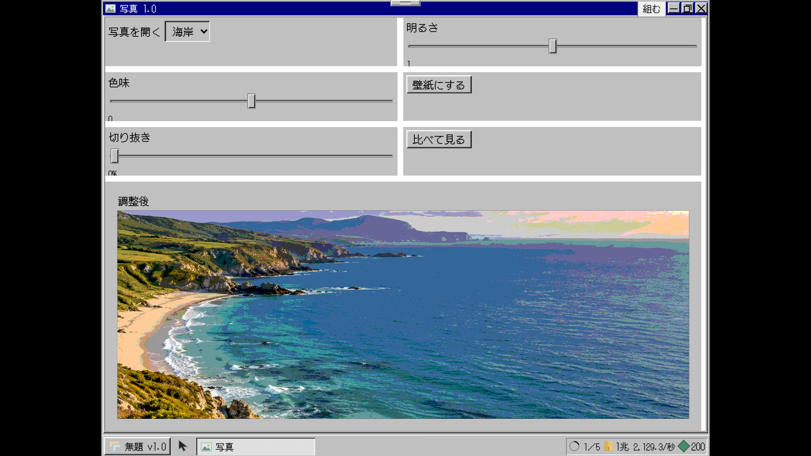
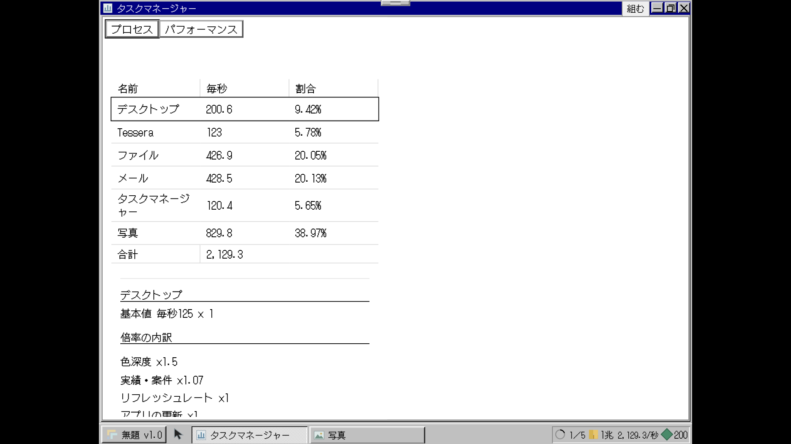

# 段階8bの確認記録

基準：main `1f0d72a`、仕様書第3版、付録A/C/F。日付は2026-11-03（日本時間）。Draft PRで確認し、mainへはマージしない。

## 8b-1 稼ぎの統合モデル

仕様書3.3・4.2・4.3・4.6・4.7・4.9。完成材料の採用グラフと生産者台帳を新設し、素材の制作とアプリへの取り付けを区別した。UIセットを買っても完成品は増えず、素材を作り、アプリへ入れたときに材料の毎秒が加わる。編集・最小化・閉じる操作でインストール済みアプリの毎秒は変わらない。

3言語（日本語・英語・長い試験用言語）×デスクトップ4段×1920×1080／1366×768の24条件で、写真の切り抜きパーツの完成→未採用時の毎秒不変→採用／インストール後の増加、タスクマネージャーの内訳の和を実操作で検証した。ページ例外・console警告／エラー・外部要求は0件。最終撮り直しと後続の結果は追記する。

単体検査：統合時点529件すべて成功。単一HTMLのTypeScript／Viteビルド成功。新たな不具合を直した部分は後続コミットで再検証する。

| 増やす前 | 採用した後 | 毎秒の内訳 |
|---|---|---|
|  |  |  |

仮決めと正本／付録の差は [実装メモ](../../実装メモ.md) に記録する。UIセットにひな型を含む正本4.9を優先し、旧付録C5の追加アプリ／機能料金は重ねて払わせない。安全配置・窓操作・8a工房は基盤として使い、経済・撮影評価・ファイルの列挙は新設計にした。
