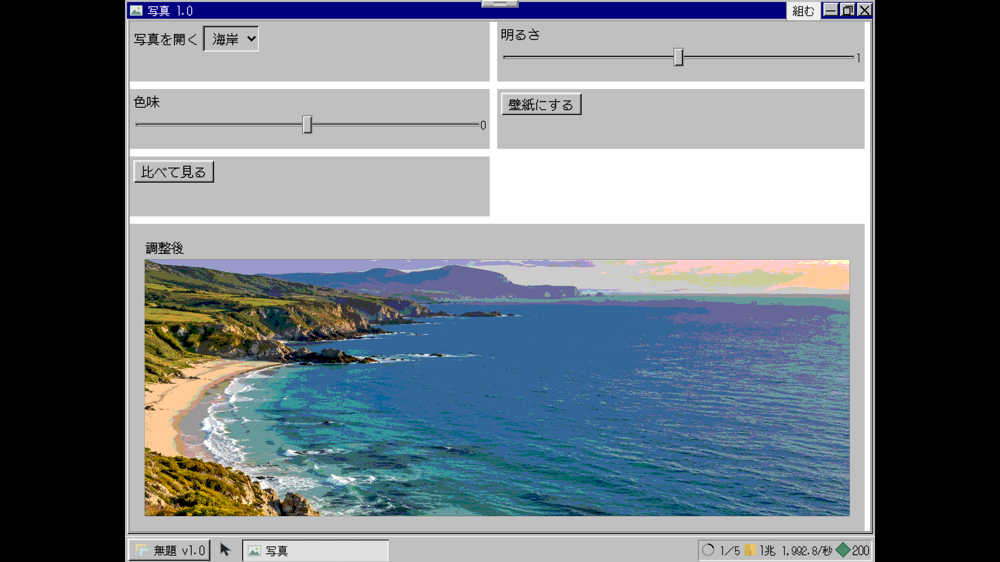
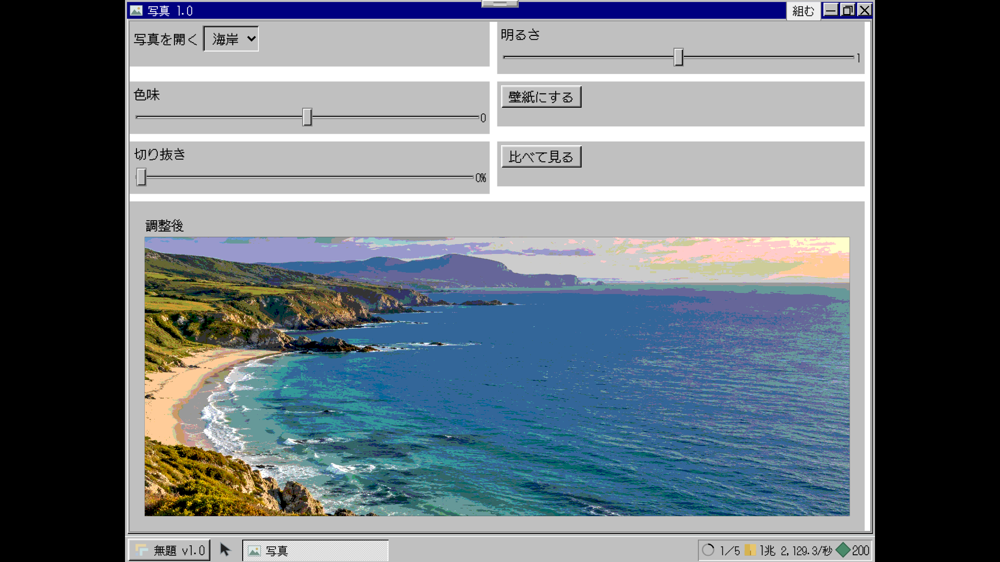
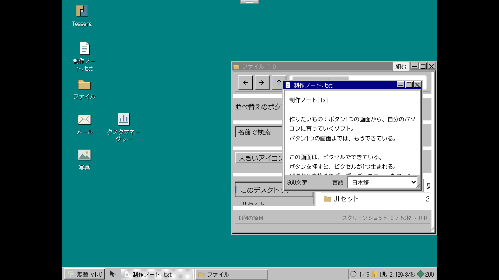
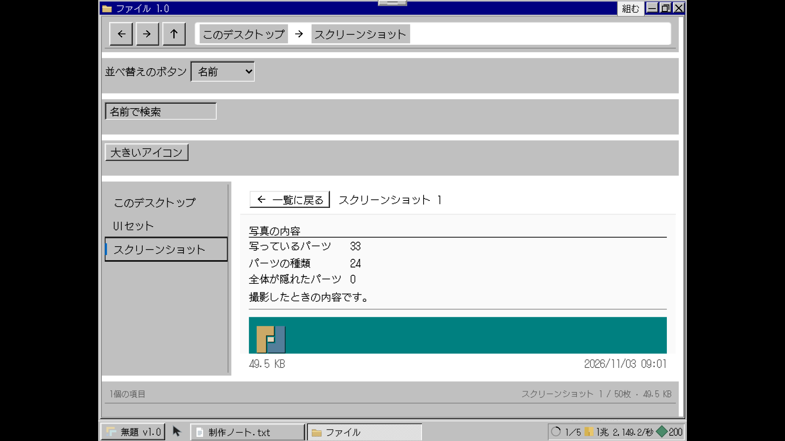

# 段階8bの確認記録

基準はmain `1f0d72a`（段階8aとPR #19を含む）、仕様書第3版、付録A/C/F。2026-11-03（日本時間）。ブランチ `codex/stage8b`、[Draft PR #20](https://github.com/naoyukihonma914-png/refresh/pull/20)。mainへはマージしない。

経済・撮影評価・ファイル列挙は新設計。8aの工房・4工程・セット・保存枠、既存の安全配置・文字測定・窓操作は基盤として使用した。旧描画や旧ホーム書類を復活させていない。依存する採用グラフと保存の基盤は8b-1でまとめて接続し、撮影／周回の追加検証と不具合修正を後続コミットへ分けた。

## 8b-1 稼ぎの統合モデル

仕様書3.3・4.2・4.3・4.6・4.7・4.9に対応。

- 生産者台帳を新設。世界3は採用した材料の毎秒の和×アプリ更新×スペック等の調整層で計算し、未採用の材料を重ねて生産者へ足さない。同じアプリで同じ材料を複数表示しても1回だけ数える。
- UIセットの権利・材料と完成品を分離。4工程で作り、アプリへ入れた後に毎秒が増える。編集中は取り付け済みの材料と毎秒を保持し、読み直し→インストールで反映する。最小化・閉じる操作では毎秒を変えない。
- ジョブの土台を稼働する道具の数へ接続。売上はUI・パーツ・アプリ・完成セットの実数を数え、旧アイコン数・書き出し回数・配置ボーナスを使わない。工程の小払いは残す。

3言語×デスクトップ4段×2サイズの24条件で、写真の切り抜きパーツを実際に完成→未採用の間は毎秒不変→採用／取り付けで増加、Managerの行の和との一致を検証した。通常のv1リリース・売上の固定・60Hz購入・v2開始も3言語×2サイズで操作した。

| 制作前 | 採用後 |
|---|---|
|  |  |

## 8b-2 撮影を内容の記録へ

仕様書4.3・4.6・4.7に対応。

可視領域の和から上位の窓・スクロール・画面外の領域を差し引き、完全に隠れた材料を除外する。手動撮影は実DOMを採集して形式11へ凍結する。写真は記録・依頼・アルバムの素材とし、小さな固定単価を使う。毎秒や整頓に連動しない。製品写真の品質も可視数と種類だけで評価する。旧写真1〜10の読取と過去の入金を保持する。

3言語×4段×2サイズで、窓を並べる／一部重ねる／完全に隠す状態を実際に撮影し、隠れたFilesの材料・背景・アイコンが0になることを確認した。後から窓を動かしてもアルバムの写真と評価は変わらない。400枚をUTF-16で5MiB以内に保存し、予備・エクスポート・取り込みを往復する単体検査も通した。

| 重なった窓の撮影 | 写っている内容の評価 |
|---|---|
|  |  |

撮影関係の単体46件、統合541件が成功。最終のビルド・画面確認の一覧は次の小段階で追記する。仮決めは [実装メモ](../../実装メモ.md) に記録した。
