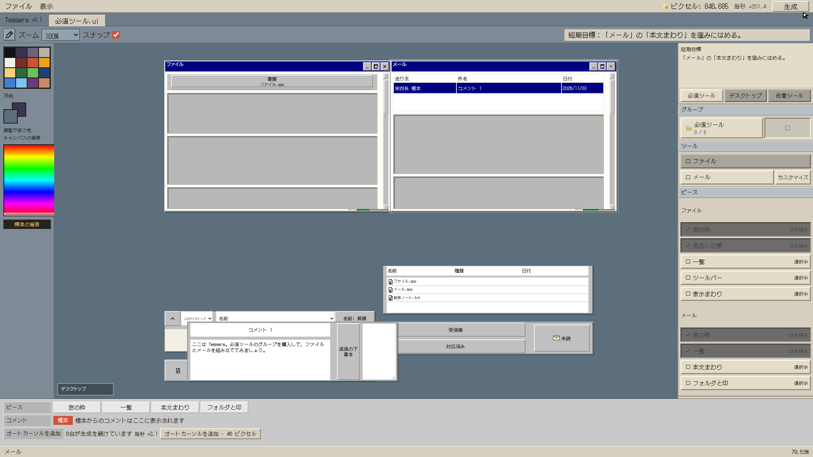
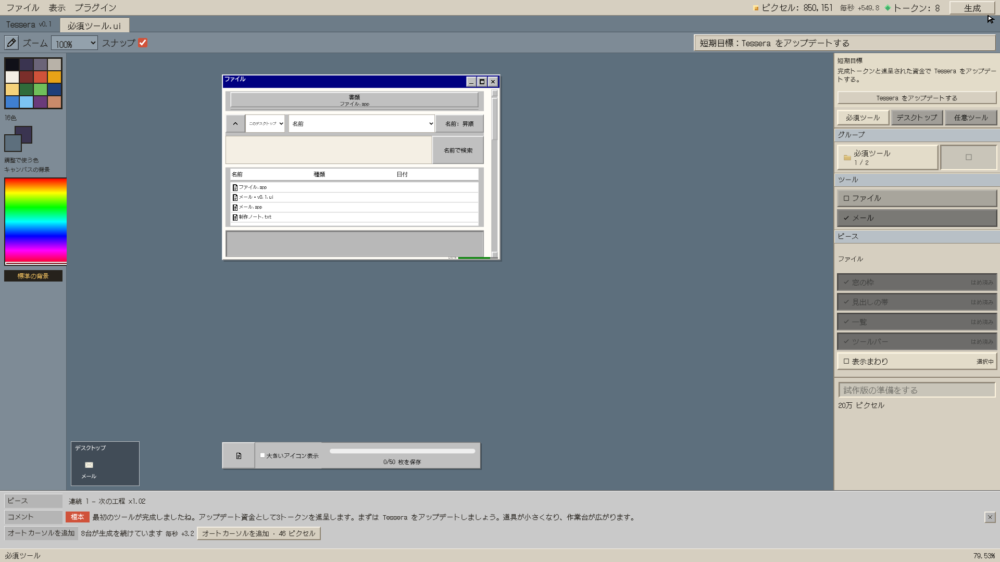
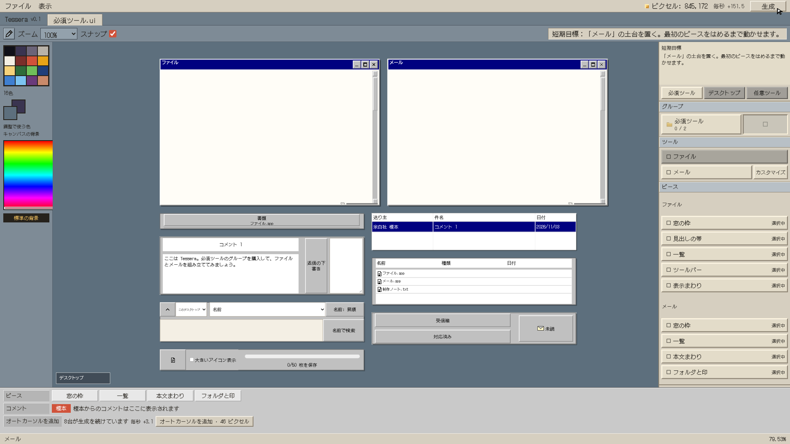
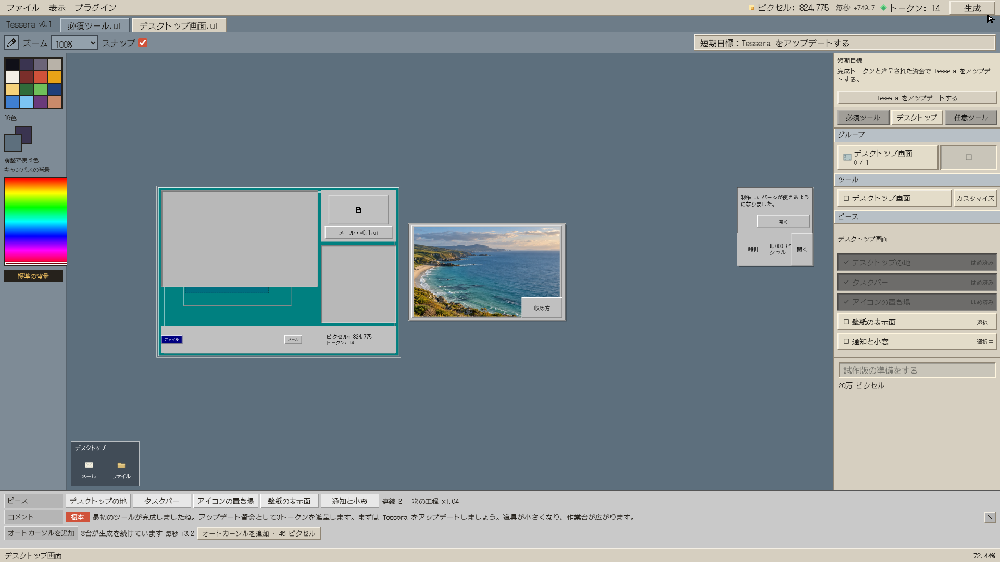

# PR #29：世界2 グループパズル化の確認

2026-11-04。既存ブランチ `codex/world2-fitting` を pull し、`97a6481` に同梱された [改修指示書](../../世界2-改修指示書-グループパズル.md) を正として実装した。現行 spec と異なる購入・完成・保存の扱いは指示書を優先。PR #36 のマージは待っていない。

## 実装した範囲

- 購入単位をグループへ変更。必須グループはファイルとメールをまとめて購入し、未完成の両ツールの9ピースを混在表示する。デスクトップ画面は独立。任意ツールは従来の購入価格を維持する。
- 共通4パーツは制作済み。共通グループの購入・制作を廃止し、各ツールへ共通分の毎秒を含める。ファイルの見出しは出来合いの1ピースとして置く。
- 自動で出る殻を廃止。タイトル・灰色の窓ボタン・スクロールバーを一体化した枠そのものを動かして置く。最初の要素をはめるまで移動可能で、その後は取り外しても位置を固定する。デスクトップは地ピースが土台。
- 全ピースの装着で、完成した姿が光り、縮みながら棚のツールアイコンへ移る。旧パーツ数分のトークンを一括付与する。完成導線に書き出しボタン・待ち状態・点滅・アイコン合体はない。完成済みツールは棚から実物を開ける。
- 分類は「必須ツール／デスクトップ／任意ツール」。短期目標→分類→グループ→ツール→全未完成ツールのピースを常設。ツール選択は強調・目標・カスタマイズの対象を変え、他ツールのピースを隠さない。
- 各旧パーツの設定をツール内の対象選択へ付け替えた。共通設定もツール別に保持する。装着後の検索・一覧・返信・写真調整・時刻・状態切替などは従来の実物描画と操作を使う。ターミナル内の旧書き出し命令は、完成済みツールを一覧にする命令へ読み替えた。
- 灰色の空の窪み、対応寸法の発光、同寸のドラッグ、仮置き、取り外し、嵌合の光と音、3段階の行の明るさ、実物ホバープレビュー、背景パレット、文字の縮小を維持した。作業台はスクロールせず全体を収め、仮置きしたピースを手前にする重なり順も保存する。
- 世界3への出口はファイル・メール・デスクトップ画面の完成で開く。世界3の材料・購入案内・組み立て画面への移動・Tesseraジョブも新グループへ接続した。

| ツール | ピース | 完成トークン |
|---|---:|---:|
| ファイル | 5 | 6 |
| メール | 4 | 5 |
| デスクトップ画面 | 5 | 6 |
| 写真 | 4 | 7 |
| ごみ箱 | 3 | 3 |
| 時計 | 3 | 3 |
| テーマ | 3 | 5 |
| ターミナル | 4 | 5 |
| タスクマネージャー | 3 | 2 |
| 追加：タブ／表 | 2／2 | 1／1 |
| **合計** | **38** | **44** |

## 保存・報酬・既存機能

- schema **19**。購入グループ、各ピースの元位置・仮置き位置、枠位置と固定状態、枠基準の相対装着座標、表示状態、重なり順、設定、完成日時、棚、支払済み履歴を保存する。
- **18以前の試遊セーブは新規開始へ戻す。移行しない。** 旧セーブの写真などの外部参照を解決する前に新規状態へ戻し、資源・製品・払い履歴を引き継がない。19の通常エクスポート／ファイル選択でのインポート／再読込は保持する。
- 旧44素材IDへの投影を残し、世界3のレシピ・採用材料・生産内訳へ渡す。要素の毎秒は統合した素材の合算。工程払いの総額を新ピース数で割り、既存の完成払い・制作段倍率・手際・連続ボーナスを維持した。価格や経済の本調整はしていない。
- 第1周の最初のツール完成で3トークンを一度だけ進呈。Tessera更新まで他トークン購入を制限する。単体検証ではファイル完成で **6＋3＝9**、更新購入後 **6**、メール完成後 **11**。再装着・再読込・次周回で二重払い／二重進呈しない。
- ブラウザの主経路は交互にはめてメールを先に完成させる。第1周は **5＋3＝8 → ファイルも完成して14 → 地も完成して20**。このケースは更新を購入せず、進呈・ロックを保持する。更新済みの別ケースでは **5 → 11 → 17** となり、実際の出口を押して世界3へ入る。初回の256色条件と試作版リリースは従来どおり。
- 配信は今回の作り替え対象外。既存のパーツ単位のはめ込み・明示的エクスポートを保つ。schema19上で購入・完成・書き出し・保存復元を別途テストした。
- 歴史的な材料方式の固定状態は、配信と凍結記録の回帰確認用に保持した。ライブの新規状態はグループ方式。旧形式の移行成功を期待していたテストは、新規開始を検証する内容へ更新し、写真・世界3・製品など形式変更と独立した検証は残した。

## 検証

- `npm --prefix game test`：**78ファイル・801件成功**。
- `npm --prefix game run build`：TypeScript検査と単一HTML生成に成功。
- `python tools/vendor_fonts.py --check`：3,733文字の集合・7書体の字形とチェックサムを確認。追加文字を含めて同梱書体を再生成した。生の検証出力は [validation.txt](validation.txt)。
- グループ専用27件：38ピースと旧44素材の対応・報酬総額・混在時の非重複・枠の移動と固定・相対座標・仮置きと重なり順・支払の一回性・11ツールの完成トークン・進呈と購入制限・設定の独立・世界3の素材と出口・ジョブ・次周回・配信・19の読み書き・旧形式の新規開始・不正状態の拒否を確認。
- Chromium実操作：日英それぞれで主経路、更新済みの世界3移行、全ツールの完成を確認。追加で英語1280×720、動きを減らす設定、長い英語表記を確認。記録は [summary.json](summary.json)、[小画面](small-screen/summary.json)、[動きを減らす](reduced-motion/summary.json)、[長い表示名](long-labels/summary.json)。
- 固定状態URLは準備にだけ使用。購入・ドラッグ・仮置き・取り外し・再装着・設定・検索・棚・出口は実UI操作。通常URLへの復元は無変更の出力ファイルを選択して読み込み、再読込後の状態を照合した。ゲーム状態の注入・デバッグ資源追加は行っていない。
- ピースの画面内収容、作業台の非スクロール、ドラッグと窪みの同寸、空の窪みの灰色、文字の収まり、ホバープレビュー、完成演出の棚への到着位置と寸法を照合。ページ例外・console警告／エラー・外部要求は各ケース0件。配信HTMLとローカルビルドのSHA-256は一致する。

## 指定スクリーンショット（1920×1080）

1. 必須グループの9ピース。枠2枚と、混在するファイル・メールの要素。


2. 両枠を置き、交互にはめ込み。メール本文は仮置き。



3. メール完成直後。棚にメール1アイコン、ファイルは組み立て途中。



4. 短期目標、3分類、グループ、ツール、両ツールの全ピース。



5. デスクトップの地を土台にした組み立て。



## 再現

```sh
npm --prefix game ci
npm --prefix game test
npm --prefix game run build
python -m http.server 8188 --bind 127.0.0.1 --directory game/dist
```

別ターミナルで実行する。Playwright PythonとChromiumが必要。

```sh
python tools/check_world2_group_puzzle.py --base-url http://127.0.0.1:8188/
python tools/check_world2_group_puzzle.py --language en --case era1 --width 1280 --height 720 --no-screenshots --output-dir docs/reviews/world2-group-puzzle/small-screen
python tools/check_world2_group_puzzle.py --language ja --case core --reduced-motion --no-screenshots --output-dir docs/reviews/world2-group-puzzle/reduced-motion
python tools/check_world2_group_puzzle.py --language en-XA --case core --no-screenshots --output-dir docs/reviews/world2-group-puzzle/long-labels
```

ブラウザ検証はビルド完了後に実行し、全体テストとは順番に実行する。画像・ログが示すビルドのハッシュは各summaryに記録する。第1〜6ラウンドの記録はその時点の履歴として残す。この文書が今回の完成導線の記録。
